# Сайты, боты и автоматизация для бизнеса

Делаю лендинги, чат-ботов, ассистентов по базе знаний, парсеры, автоматизацию заявок и таблицы, запускаю проекты на сервере. Каждую работу запускаю и проверяю сам: автотесты, проверка на телефоне, честные цифры.

Здесь — 9 услуг, по 5 работ в каждой. Почти у всех работ есть живое демо или открытый код.

## Услуги

| № | Услуга | Что даёт бизнесу |
|---|---|---|
| 1 | [Лендинг под ключ](#1-лендинг-под-ключ) | Реклама ведёт на страницу, которая превращает переходы в заявки, а Метрика показывает, какой канал их приносит. |
| 2 | [Вёрстка по макету](#2-вёрстка-по-макету) | Дизайн, за который уже заплачено, становится сайтом без искажений и одинаково выглядит у всех клиентов. |
| 3 | [Правки и доработка сайта](#3-правки-и-доработка-сайта) | Сломанная кнопка или форма незаметно съедает заявки. Точечная правка возвращает их без переделки всего сайта. |
| 4 | [Чат-бот для бизнеса](#4-чат-бот-для-бизнеса) | Клиент записывается или оставляет заявку в любое время, а администратор занимается клиентами, а не перепиской. |
| 5 | [Ассистент по базе знаний](#5-ассистент-по-базе-знаний) | Снимает с менеджеров повторяющиеся вопросы и отвечает клиентам вечером и в выходные. |
| 6 | [Парсинг сайтов](#6-парсинг-сайтов) | Цены конкурентов, каталоги поставщиков и базы клиентов собираются автоматически, а не копируются вручную. |
| 7 | [Автоматизация заявок](#7-автоматизация-заявок) | Заявки не теряются между сайтом, почтой и мессенджером, а руководитель видит цифры без ручных отчётов. |
| 8 | [Формулы и отчёты в Excel](#8-формулы-и-отчёты-в-excel) | Таблица считает сама, поэтому меньше ручной работы и ошибок в деньгах и остатках. |
| 9 | [Запуск на сервере](#9-запуск-на-сервере) | Сайт и бот работают круглосуточно по HTTPS, а резервные копии берегут данные от потери. |

## 1. Лендинг под ключ

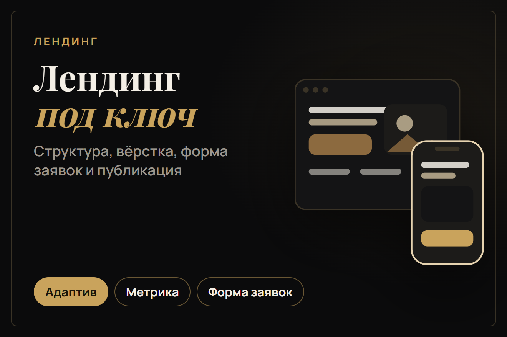

Продающий одностраничный сайт: структура, адаптивная вёрстка, форма заявки, Метрика и публикация на вашем домене.

**Зачем бизнесу:** Реклама ведёт на страницу, которая превращает переходы в заявки, а Метрика показывает, какой канал их приносит.

<table>
<tr><td width="33%" valign="top"><a href="portfolio/landing-barbershop.png">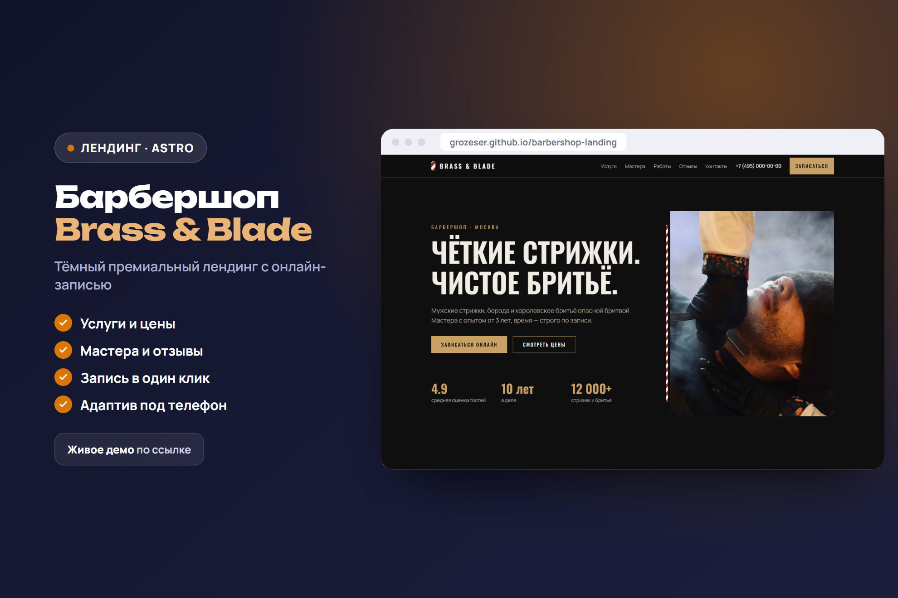</a> <b>Барбершоп Brass & Blade</b> Тёмный лендинг с услугами, ценами, мастерами и отзывами. Клиент записывается в один клик прямо с телефона, без звонка администратору. [демо](https://grozeser.github.io/barbershop-landing/) · [код](https://github.com/grozeser/barbershop-landing)</td><td width="33%" valign="top"> <b>Стоматология White Mint</b> Подбор лечения за 30 секунд, цены, врачи, отзывы и гарантии. Пациент сразу понимает, сколько стоит лечение и к кому идти, и оставляет заявку на запись. [демо](https://grozeser.github.io/dental-landing/) · [код](https://github.com/grozeser/dental-landing)</td><td width="33%" valign="top"> <b>Цветочная студия «Хлорис»</b> Каталог букетов, условия доставки и оплаты, форма заказа. Страница лёгкая и быстро открывается с телефона, поэтому покупатель доходит до заказа. [демо](https://grozeser.github.io/chloris-flower-landing/) · [код](https://github.com/grozeser/chloris-flower-landing)</td></tr>
<tr><td width="33%" valign="top"><a href="portfolio/landing-remont.png">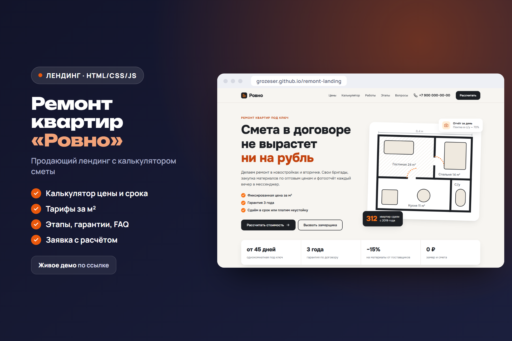</a> <b>Ремонт квартир «Ровно»</b> Калькулятор сметы: посетитель вводит площадь и видит примерную цену и срок ремонта, рядом тарифы за м², этапы, гарантии и FAQ. Заявка приходит уже с расчётом, и менеджер звонит подготовленным. [демо](https://grozeser.github.io/remont-landing/) · [код](https://github.com/grozeser/remont-landing)</td><td width="33%" valign="top"><a href="portfolio/landing-english.png">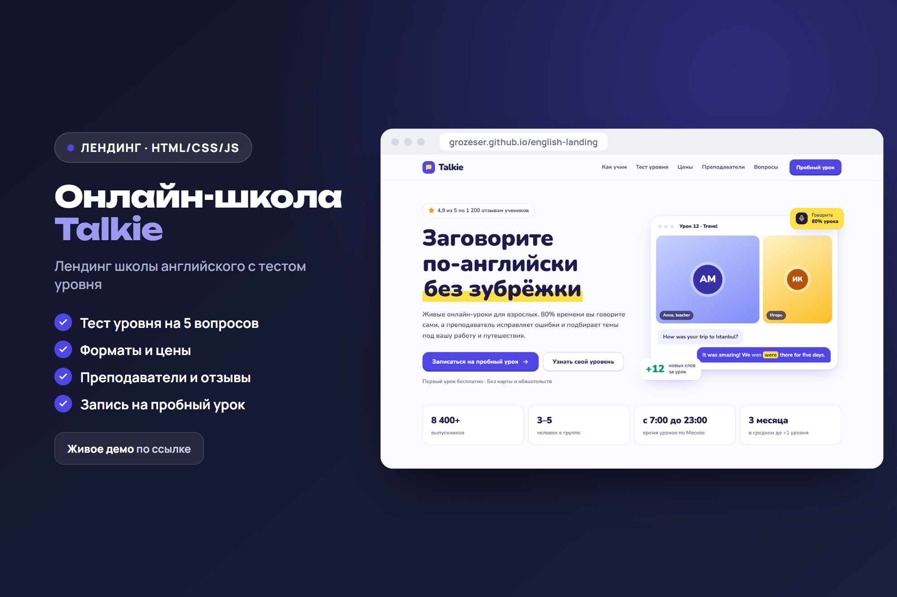</a> <b>Онлайн-школа Talkie</b> Тест уровня из 5 вопросов, форматы обучения, преподаватели, отзывы и запись на пробный урок. Тест вовлекает посетителя, и он записывается уже со своим уровнем. [демо](https://grozeser.github.io/english-landing/) · [код](https://github.com/grozeser/english-landing)</td></tr>
</table>

<a href="#услуги">↑ к списку услуг</a>

## 2. Вёрстка по макету

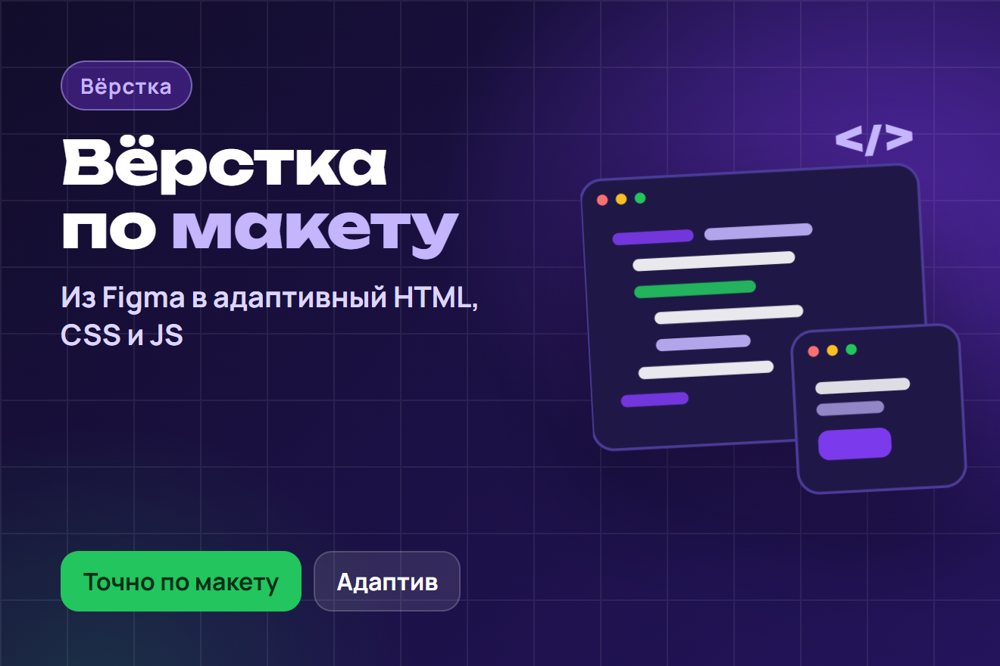

Точная адаптивная вёрстка из Figma: HTML, CSS, JavaScript, React или Next.js. Проверка на телефоне и во всех браузерах.

**Зачем бизнесу:** Дизайн, за который уже заплачено, становится сайтом без искажений и одинаково выглядит у всех клиентов.

<table>
<tr><td width="33%" valign="top"><a href="portfolio/markup-dental.png">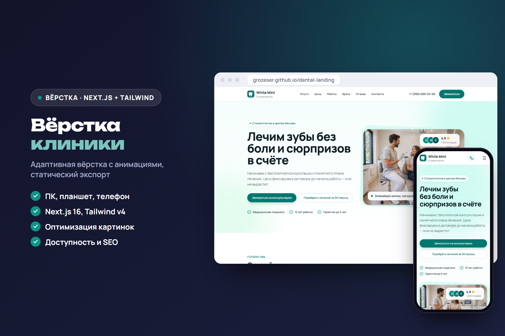</a> <b>Next.js + Tailwind</b> Вёрстка клиники на Next.js 16 и Tailwind v4: анимации, оптимизированные картинки, доступность и SEO. Сайт одинаково выглядит на ПК, планшете и телефоне и готов к продвижению в поиске. [демо](https://grozeser.github.io/dental-landing/) · [код](https://github.com/grozeser/dental-landing)</td><td width="33%" valign="top"><a href="portfolio/markup-barbershop.png">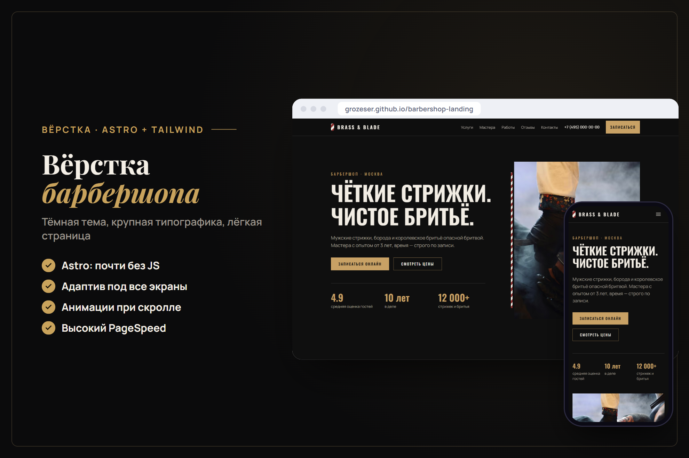</a> <b>Astro + Tailwind</b> Тёмная тема, крупная типографика и анимации при скролле, почти без JavaScript. Лёгкая страница быстро открывается даже на мобильном интернете и получает высокий балл PageSpeed. [демо](https://grozeser.github.io/barbershop-landing/) · [код](https://github.com/grozeser/barbershop-landing)</td><td width="33%" valign="top"><a href="portfolio/markup-omega.png">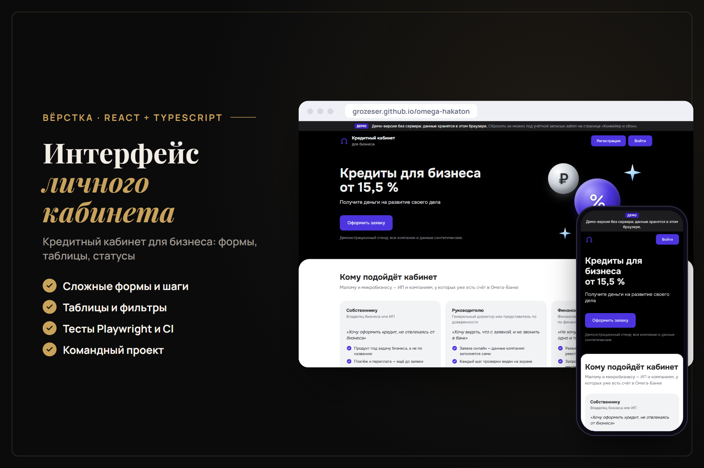</a> <b>React + TypeScript, личный кабинет</b> Кредитный кабинет для бизнеса: многошаговые формы, таблицы с фильтрами, статусы заявок. Интерфейс покрыт тестами Playwright и проверяется в CI, поэтому ошибки ловятся до того, как их увидит клиент. Командный проект с хакатона. [демо](https://grozeser.github.io/omega-hakaton/) · [код](https://github.com/grozeser/omega-hakaton)</td></tr>
<tr><td width="33%" valign="top"> <b>Чистый HTML/CSS/JS</b> Семантичная разметка и адаптив на CSS Grid без библиотек. Такой сайт работает на любом хостинге, а править его сможет любой верстальщик. [демо](https://grozeser.github.io/chloris-flower-landing/) · [код](https://github.com/grozeser/chloris-flower-landing)</td><td width="33%" valign="top"><a href="portfolio/markup-english.png">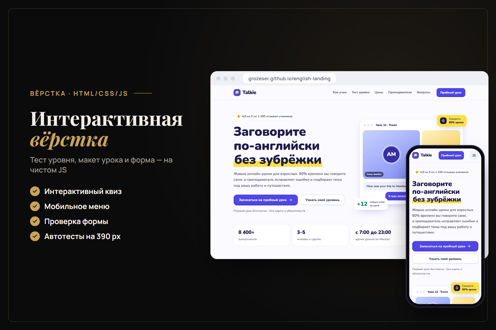</a> <b>Интерактив на JavaScript</b> Квиз, мобильное меню и проверка формы на чистом JavaScript, автотесты на ширине телефона 390 px. Интерактив работает на телефоне, а форма не пропускает пустые заявки. [демо](https://grozeser.github.io/english-landing/) · [код](https://github.com/grozeser/english-landing)</td></tr>
</table>

<a href="#услуги">↑ к списку услуг</a>

## 3. Правки и доработка сайта

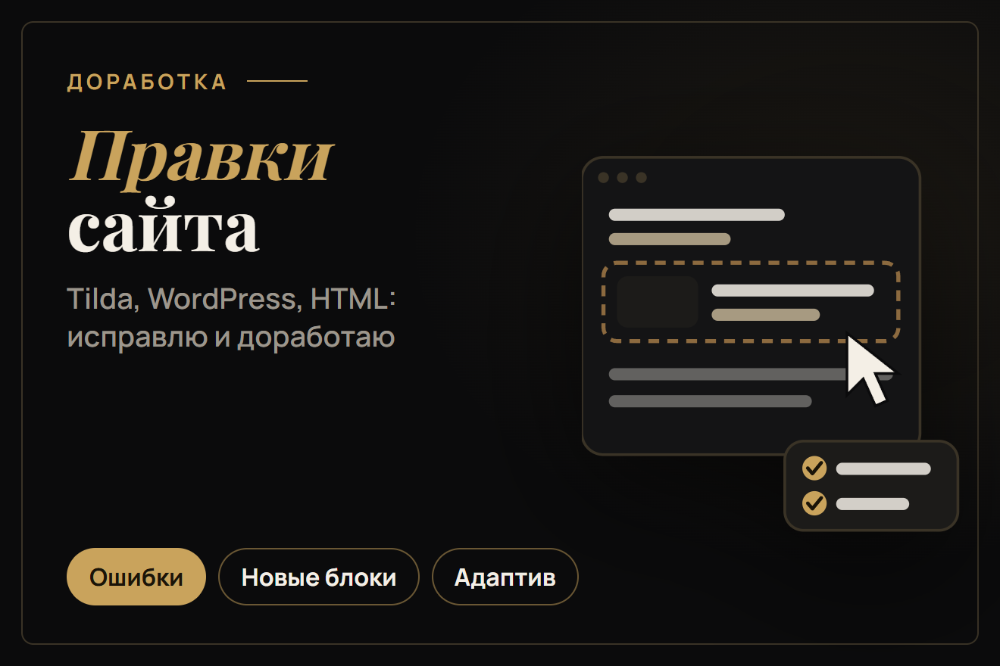

Исправлю «поехавшую» вёрстку, неработающие формы, медленную загрузку; добавлю блоки и перенесу сайт.

**Зачем бизнесу:** Сломанная кнопка или форма незаметно съедает заявки. Точечная правка возвращает их без переделки всего сайта.

<table>
<tr><td width="33%" valign="top"><a href="portfolio/fix-overflow.png">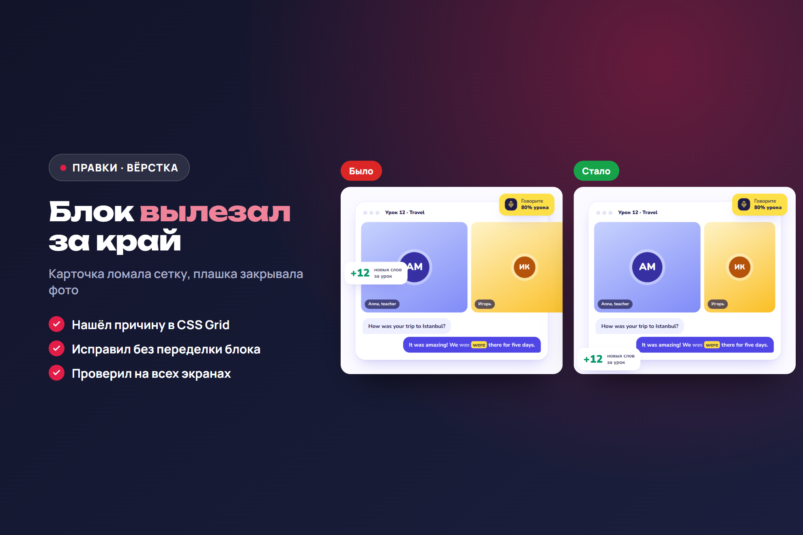</a> <b>Блок вылезал за край</b> Карточка ломала сетку, плашка закрывала фото. Нашёл причину в CSS Grid, исправил без переделки блока и проверил на всех экранах. Страница снова выглядит аккуратно и вызывает доверие. [демо](https://grozeser.github.io/english-landing/) · [код](https://github.com/grozeser/english-landing)</td><td width="33%" valign="top"><a href="portfolio/fix-header.png">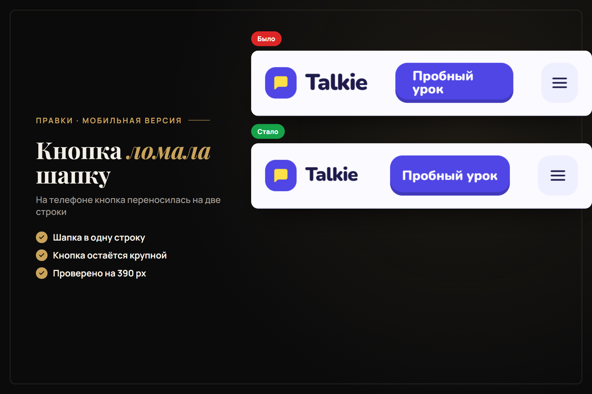</a> <b>Кнопка ломала шапку на телефоне</b> На телефоне кнопка в шапке переносилась на две строки. Теперь шапка в одну строку, а кнопка осталась крупной и заметной, проверено на ширине 390 px. [демо](https://grozeser.github.io/english-landing/) · [код](https://github.com/grozeser/english-landing)</td><td width="33%" valign="top"><a href="portfolio/fix-mobile.png">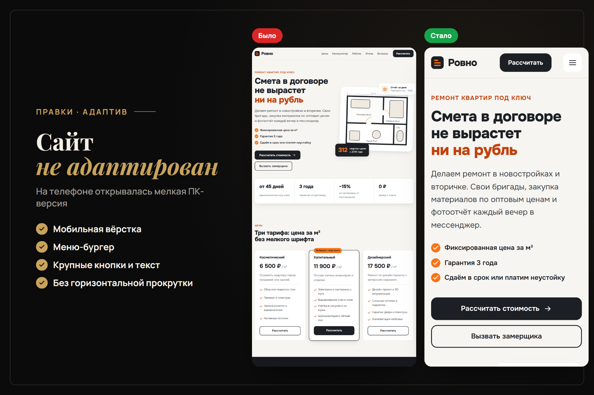</a> <b>Сайт без адаптива</b> На телефоне открывалась мелкая ПК-версия. Сделал мобильную вёрстку с меню-бургером, крупными кнопками и текстом, без горизонтальной прокрутки. С телефона теперь удобно читать и оставлять заявку. [демо](https://grozeser.github.io/remont-landing/) · [код](https://github.com/grozeser/remont-landing)</td></tr>
<tr><td width="33%" valign="top"><a href="portfolio/fix-form.png">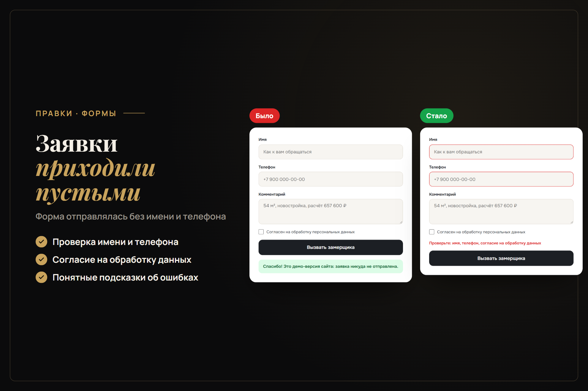</a> <b>Пустые заявки с формы</b> Форма отправлялась без имени и телефона, и менеджер получал пустые заявки. Добавил проверку полей, согласие на обработку данных и понятные подсказки об ошибках. Теперь в каждой заявке есть контакт. [демо](https://grozeser.github.io/remont-landing/) · [код](https://github.com/grozeser/remont-landing)</td><td width="33%" valign="top"> <b>Ответ прятался под кнопками</b> Последнее сообщение чата уходило под кнопки, и клиент не видел ответ. Нашёл ошибку в прокрутке, исправил одной строкой и добавил автотест, чтобы она не вернулась. [демо](https://grozeser.github.io/ai-assistants-demo/) · [код](https://github.com/grozeser/ai-assistants-demo)</td></tr>
</table>

<a href="#услуги">↑ к списку услуг</a>

## 4. Чат-бот для бизнеса

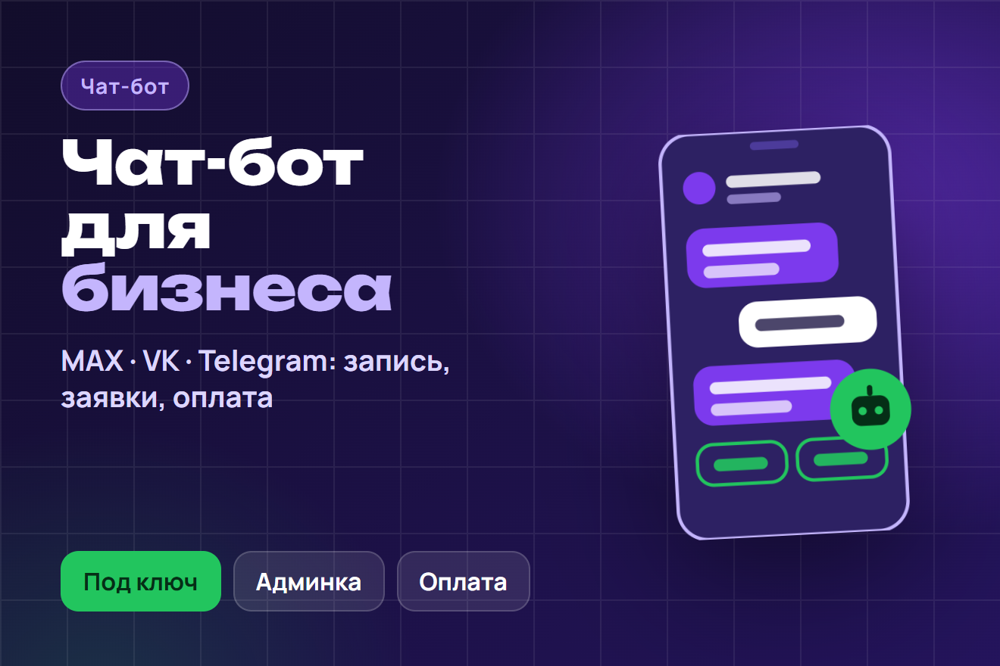

Бот принимает заявки и записывает клиентов вместо вас: меню, запись, каталог, оплата, уведомления менеджеру.

**Зачем бизнесу:** Клиент записывается или оставляет заявку в любое время, а администратор занимается клиентами, а не перепиской.

<table>
<tr><td width="33%" valign="top"><a href="portfolio/bot-booking.png">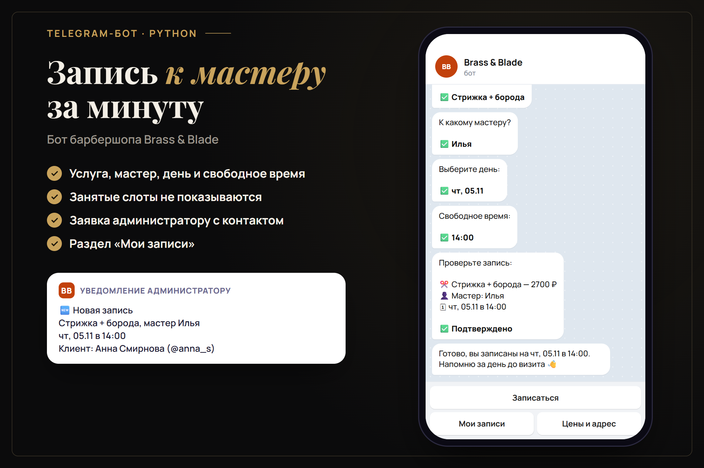</a> <b>Запись в барбершоп</b> Клиент сам выбирает услугу, мастера, день и свободное время, занятые слоты бот не показывает. Администратор получает заявку с контактом, клиент видит свои визиты в разделе «Мои записи». Запись идёт и ночью, без звонков. [код](https://github.com/grozeser/telegram-bots-demo)</td><td width="33%" valign="top"><a href="portfolio/bot-leads.png">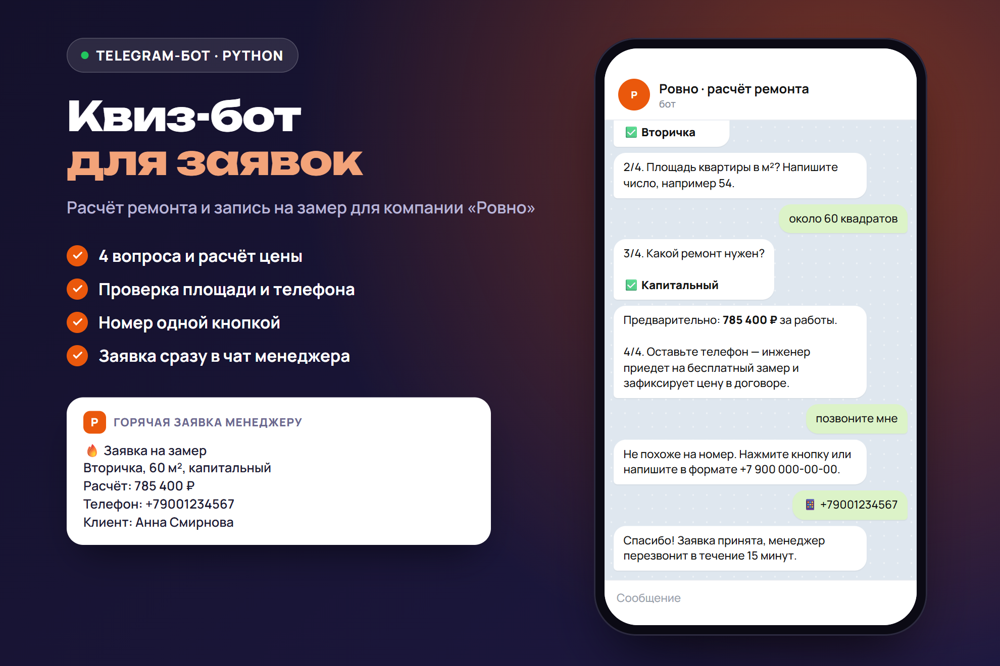</a> <b>Квиз-заявки на ремонт</b> Четыре вопроса, и бот считает цену ремонта, проверяет площадь и телефон, номер отправляется одной кнопкой. Заявка с расчётом сразу приходит в чат менеджера. [код](https://github.com/grozeser/telegram-bots-demo)</td><td width="33%" valign="top"><a href="portfolio/bot-shop.png">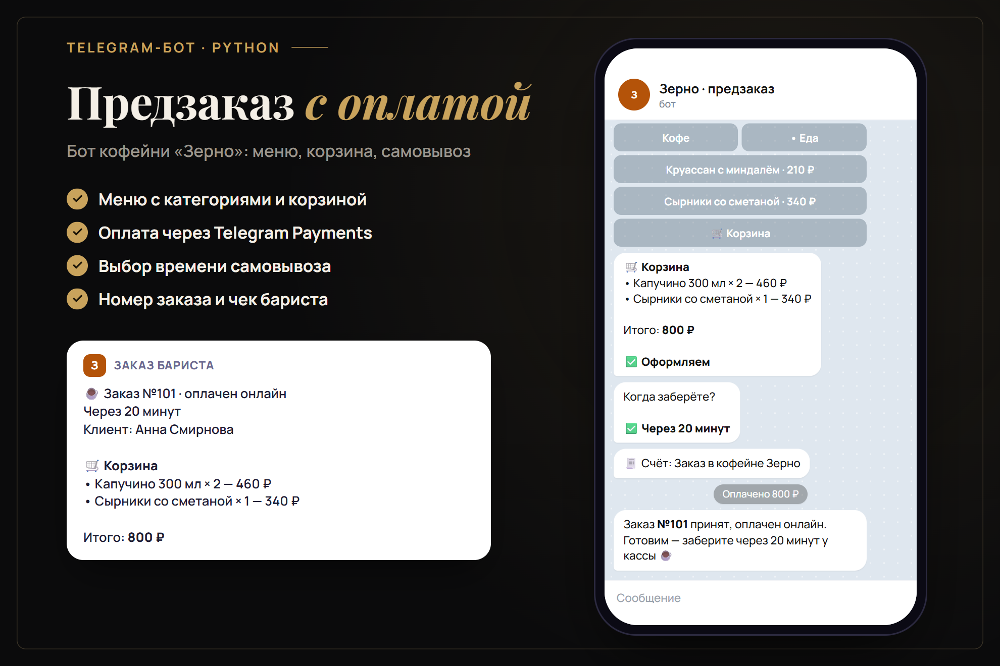</a> <b>Предзаказ с оплатой</b> Меню кофейни с категориями и корзиной, выбор времени самовывоза и оплата через Telegram Payments. Бариста получает номер заказа и чек, клиент забирает кофе без очереди на кассе. [код](https://github.com/grozeser/telegram-bots-demo)</td></tr>
<tr><td width="33%" valign="top"><a href="portfolio/bot-support.png">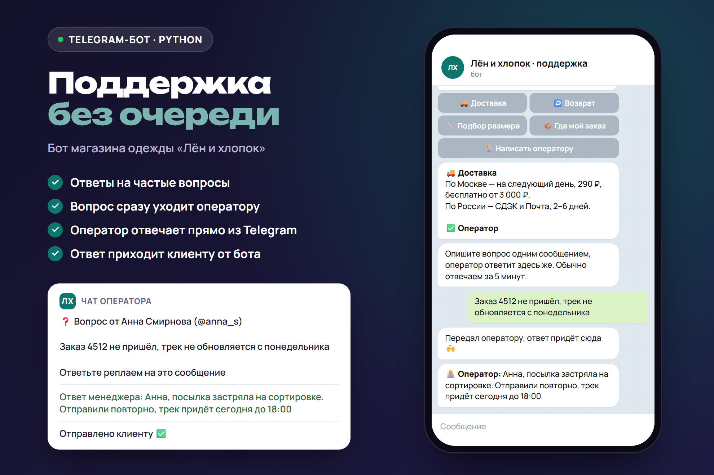</a> <b>Поддержка с оператором</b> Бот магазина отвечает на частые вопросы, а сложный вопрос сразу передаёт оператору. Оператор отвечает прямо из Telegram, клиент получает ответ от бота. Поддержка не тонет в одинаковых вопросах. [код](https://github.com/grozeser/telegram-bots-demo)</td><td width="33%" valign="top"><a href="portfolio/bot-school.png">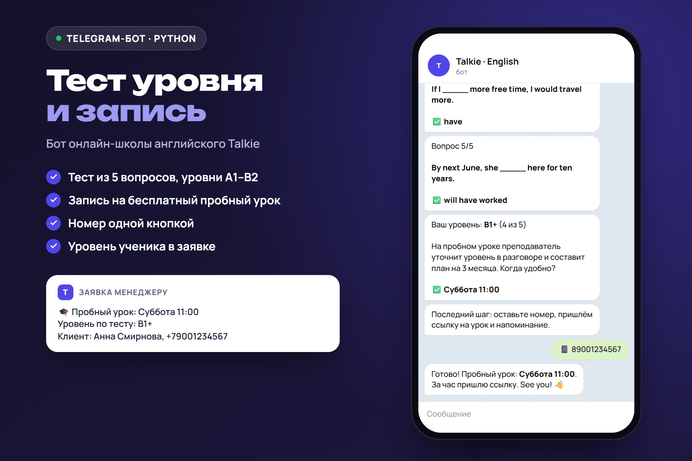</a> <b>Тест уровня и запись</b> Тест из 5 вопросов определяет уровень от A1 до B2 и записывает на бесплатный пробный урок. Уровень ученика уже указан в заявке, менеджеру не нужно его выяснять. [код](https://github.com/grozeser/telegram-bots-demo)</td></tr>
</table>

<a href="#услуги">↑ к списку услуг</a>

## 5. Ассистент по базе знаний

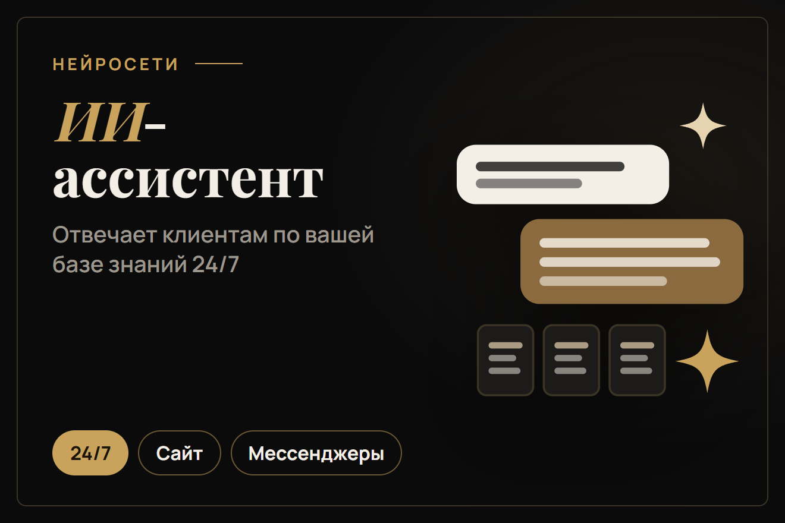

Отвечает клиентам по вашим ценам и условиям, показывает источник, а если ответа нет — зовёт менеджера, ничего не выдумывая.

**Зачем бизнесу:** Снимает с менеджеров повторяющиеся вопросы и отвечает клиентам вечером и в выходные.

<table>
<tr><td width="33%" valign="top"><a href="portfolio/ai-dental.png">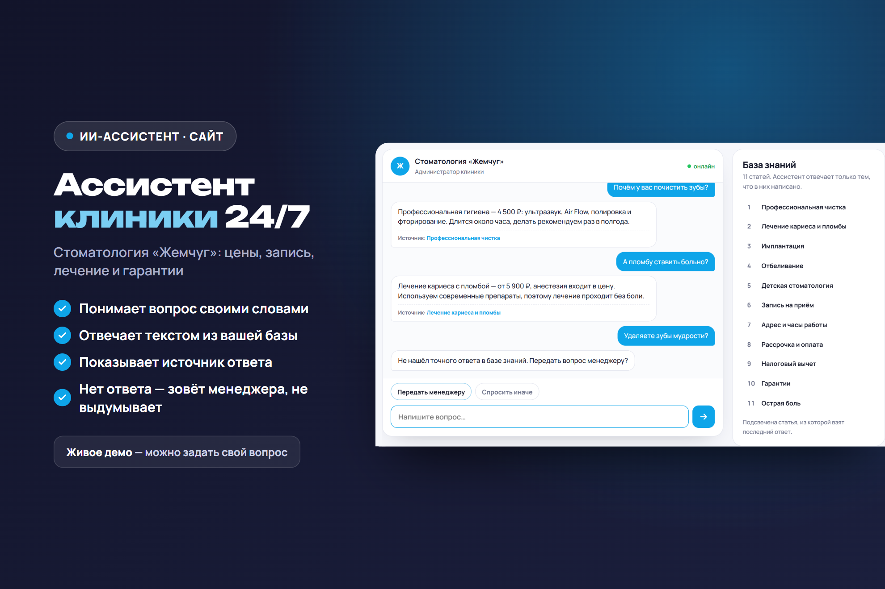</a> <b>Стоматология</b> Отвечает пациентам про цены, запись, лечение и гарантии и понимает вопрос, заданный своими словами. Берёт ответ только из базы клиники и показывает источник, а если ответа нет, передаёт вопрос менеджеру. [демо](https://grozeser.github.io/ai-assistants-demo/) · [код](https://github.com/grozeser/ai-assistants-demo)</td><td width="33%" valign="top"><a href="portfolio/ai-shop.png">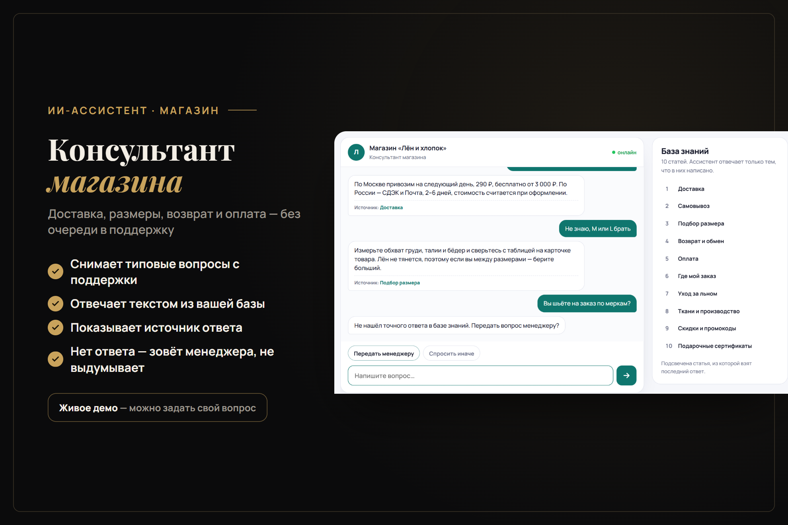</a> <b>Магазин одежды</b> Консультирует по доставке, размерам, возврату и оплате. Снимает типовые вопросы с поддержки и отвечает строго по правилам магазина. [демо](https://grozeser.github.io/ai-assistants-demo/) · [код](https://github.com/grozeser/ai-assistants-demo)</td><td width="33%" valign="top"><a href="portfolio/ai-auto.png">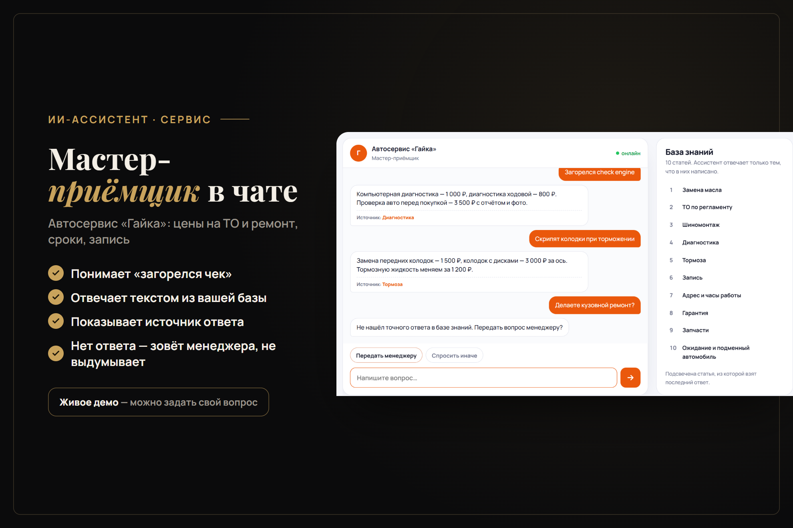</a> <b>Автосервис</b> Мастер-приёмщик в чате: цены на ТО и ремонт, сроки, запись. Понимает бытовые формулировки вроде «загорелся чек» и отвечает по прайсу сервиса, не придумывая цифр. [демо](https://grozeser.github.io/ai-assistants-demo/) · [код](https://github.com/grozeser/ai-assistants-demo)</td></tr>
<tr><td width="33%" valign="top"><a href="portfolio/ai-hr.png">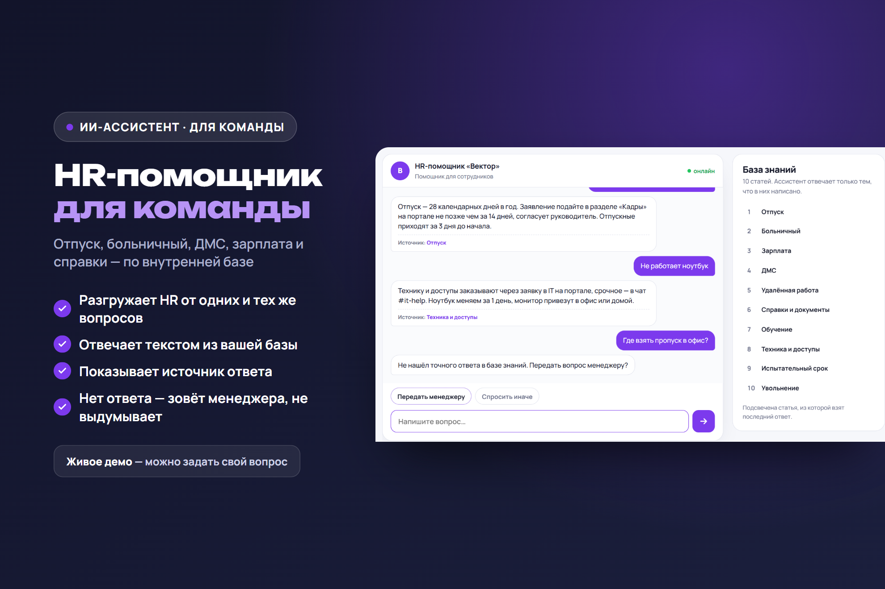</a> <b>HR-помощник для команды</b> Отвечает сотрудникам про отпуск, больничный, ДМС, зарплату и справки по внутренней базе. HR перестаёт отвечать на одни и те же вопросы, а сотрудник видит, из какого документа ответ. [демо](https://grozeser.github.io/ai-assistants-demo/) · [код](https://github.com/grozeser/ai-assistants-demo)</td><td width="33%" valign="top"><a href="portfolio/ai-shturman.png">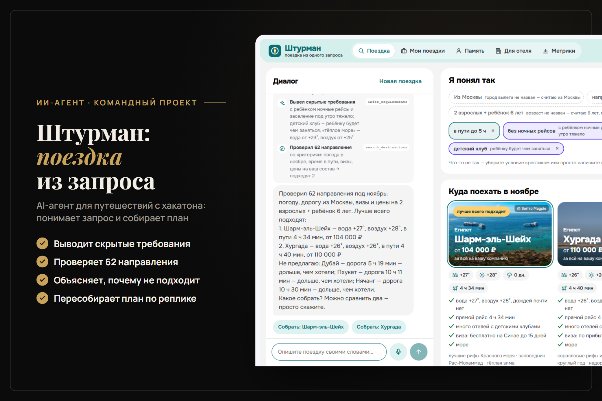</a> <b>Штурман: AI-агент (командный проект)</b> Агент для путешествий с хакатона: понимает запрос, выводит скрытые требования, проверяет 62 направления, объясняет, почему вариант не подходит, и пересобирает план по одной реплике. [код](https://github.com/grozeser/shturman)</td></tr>
</table>

<a href="#услуги">↑ к списку услуг</a>

## 6. Парсинг сайтов

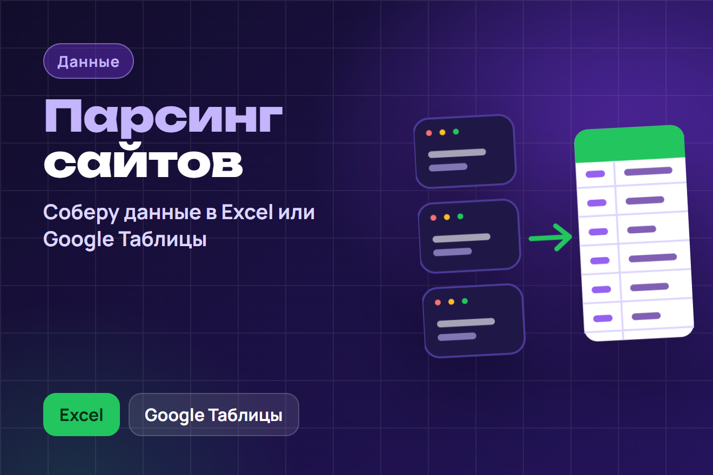

Соберу данные с сайтов в Excel, CSV или Google Таблицы: без дублей, в едином формате, по расписанию.

**Зачем бизнесу:** Цены конкурентов, каталоги поставщиков и базы клиентов собираются автоматически, а не копируются вручную.

<table>
<tr><td width="33%" valign="top"><a href="portfolio/parser-books.png">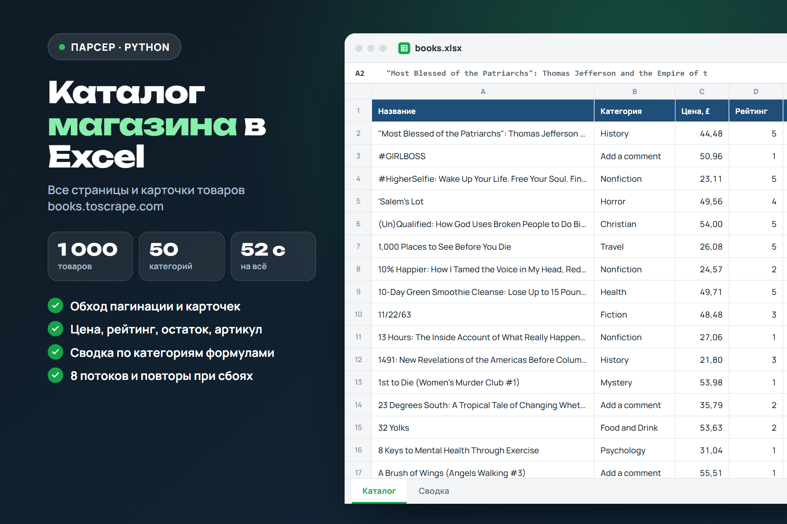</a> <b>Каталог магазина: 1 000 товаров</b> Обходит все страницы и карточки и берёт цену, рейтинг, остаток и артикул. Работает в 8 потоков с повторами при сбоях, в Excel сразу сводка по категориям формулами. Так собирают каталог конкурента или поставщика, чтобы сравнить цены. [код](https://github.com/grozeser/parsers-demo)</td><td width="33%" valign="top"><a href="portfolio/parser-quotes.png">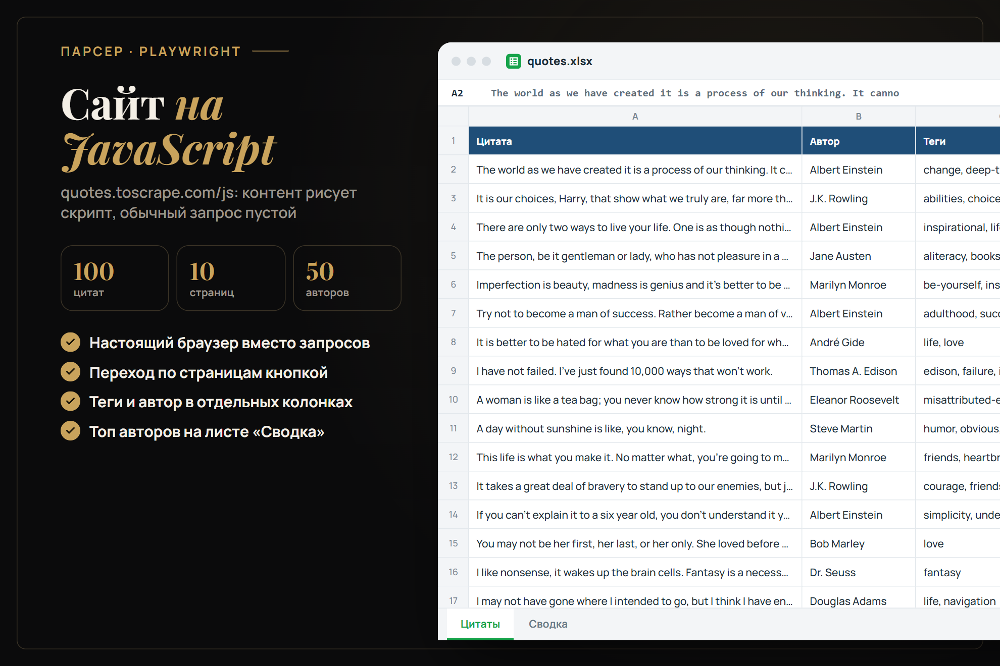</a> <b>Сайт на JavaScript (Playwright)</b> Сайт рисует контент скриптом, и обычный запрос возвращает пустую страницу. Парсер открывает настоящий браузер, листает страницы кнопкой и раскладывает автора и теги по колонкам, на листе «Сводка» топ авторов. [код](https://github.com/grozeser/parsers-demo)</td><td width="33%" valign="top"><a href="portfolio/parser-oscars.png">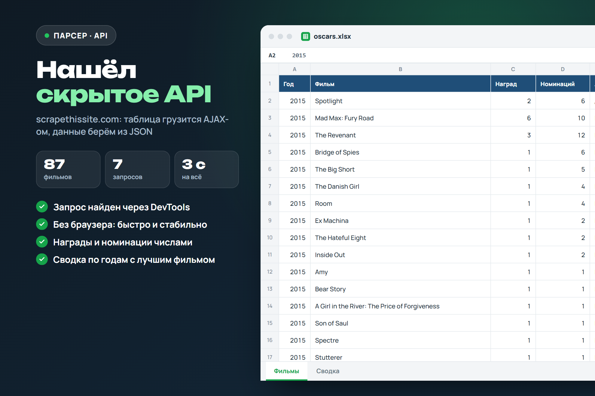</a> <b>Скрытое AJAX-API</b> Таблица подгружается AJAX-ом. Нашёл запрос через DevTools и беру данные из JSON без браузера, так быстрее и стабильнее. Награды и номинации сохраняются числами, есть сводка по годам. [код](https://github.com/grozeser/parsers-demo)</td></tr>
<tr><td width="33%" valign="top"><a href="portfolio/parser-hockey.png">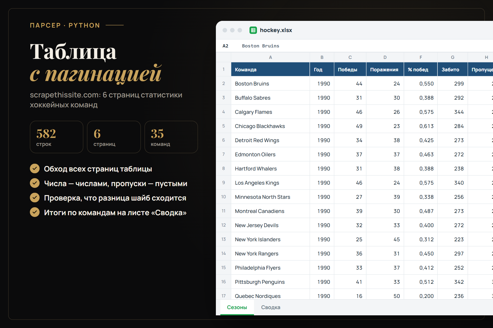</a> <b>Таблица с пагинацией</b> Обходит 6 страниц статистики, числа сохраняет числами, пропуски оставляет пустыми и проверяет, что разница шайб сходится. Данные можно сразу считать, без ручной чистки, итоги по командам на листе «Сводка». [код](https://github.com/grozeser/parsers-demo)</td><td width="33%" valign="top"><a href="portfolio/parser-client-search.png">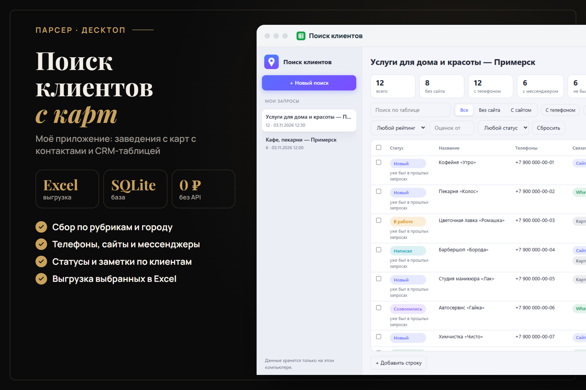</a> <b>Поиск клиентов с карт</b> Моё десктоп-приложение: собирает заведения с карт по рубрике и городу вместе с телефонами, сайтами и мессенджерами. Внутри CRM-таблица со статусами и заметками, выбранных клиентов можно выгрузить в Excel. Готовая база для звонков и рассылок. [код](https://github.com/grozeser/client-search)</td></tr>
</table>

<a href="#услуги">↑ к списку услуг</a>

## 7. Автоматизация заявок

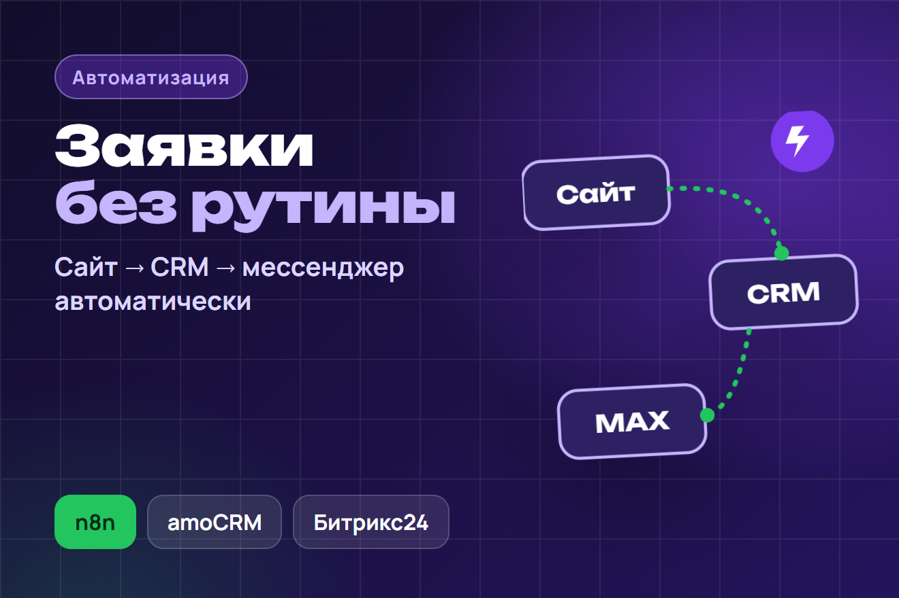

Заявки сами попадают в CRM и таблицу, менеджер получает уведомление, руководитель — отчёт. n8n на вашем сервере.

**Зачем бизнесу:** Заявки не теряются между сайтом, почтой и мессенджером, а руководитель видит цифры без ручных отчётов.

<table>
<tr><td width="33%" valign="top"><a href="portfolio/auto-lead.png">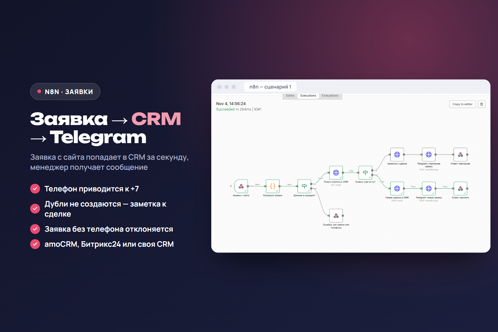</a> <b>Заявка → CRM → Telegram</b> Заявка с сайта за секунду попадает в CRM, менеджер получает сообщение в Telegram. Телефон приводится к формату +7, повторная заявка добавляется заметкой к сделке, заявка без телефона отклоняется. Подходит amoCRM, Битрикс24 или своя CRM. [код](https://github.com/grozeser/automation-demo)</td><td width="33%" valign="top"><a href="portfolio/auto-sheet.png">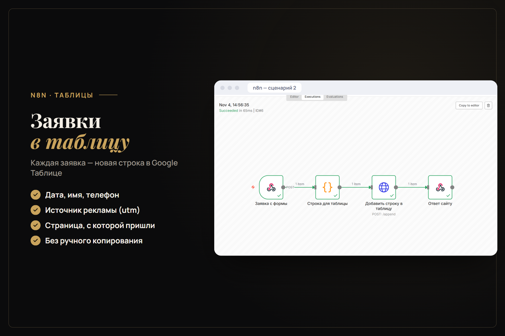</a> <b>Заявки в Google Таблицу</b> Каждая заявка становится строкой в таблице: дата, имя, телефон, источник рекламы (utm) и страница, с которой пришёл клиент. Видно, какая реклама приводит клиентов, и никто не копирует заявки вручную. [код](https://github.com/grozeser/automation-demo)</td><td width="33%" valign="top"><a href="portfolio/auto-payment.png">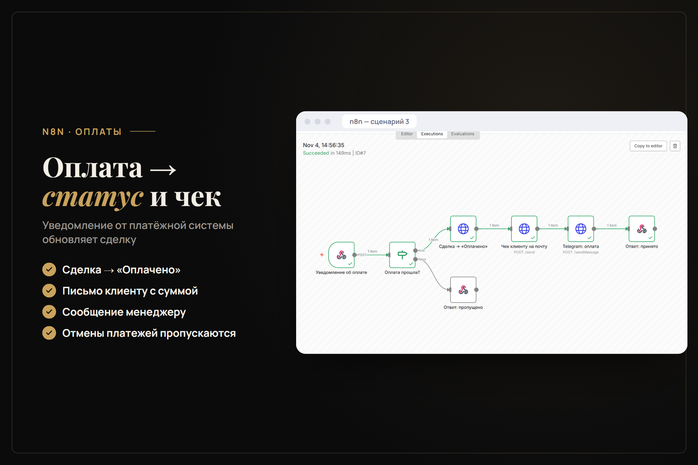</a> <b>Оплата → статус и чек</b> Уведомление от платёжной системы переводит сделку в «Оплачено», клиенту уходит письмо с суммой, менеджеру сообщение. Отменённые платежи пропускаются. Сверять оплаты вручную больше не нужно. [код](https://github.com/grozeser/automation-demo)</td></tr>
<tr><td width="33%" valign="top"><a href="portfolio/auto-report.png">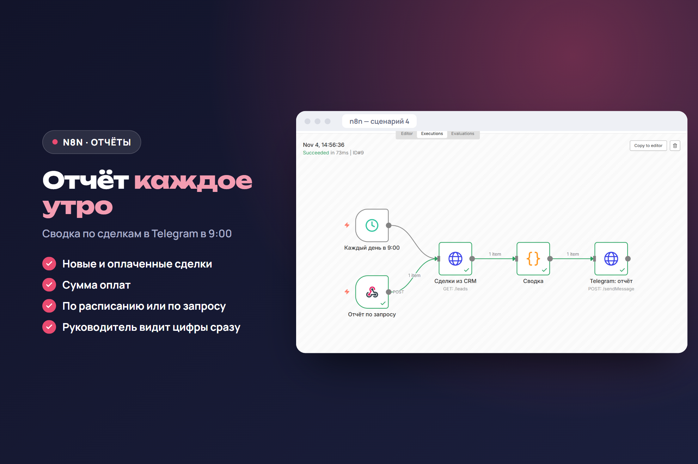</a> <b>Отчёт каждое утро</b> В 9:00 в Telegram приходит сводка: новые и оплаченные сделки и сумма оплат, отчёт можно запросить и в любой момент. Руководитель видит цифры сразу, без выгрузок из CRM. [код](https://github.com/grozeser/automation-demo)</td><td width="33%" valign="top"><a href="portfolio/auto-feedback.png">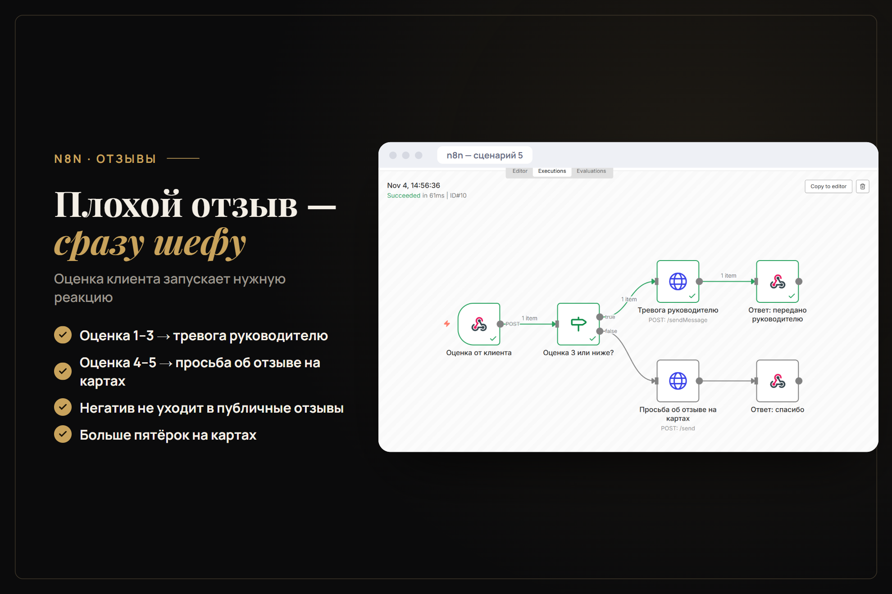</a> <b>Отзывы: плохой — сразу руководителю</b> Оценка от 1 до 3 сразу уходит руководителю как тревога, оценка 4–5 запускает просьбу оставить отзыв на картах. Недовольного клиента успевают услышать до публичного отзыва, а пятёрок на картах становится больше. [код](https://github.com/grozeser/automation-demo)</td></tr>
</table>

<a href="#услуги">↑ к списку услуг</a>

## 8. Формулы и отчёты в Excel

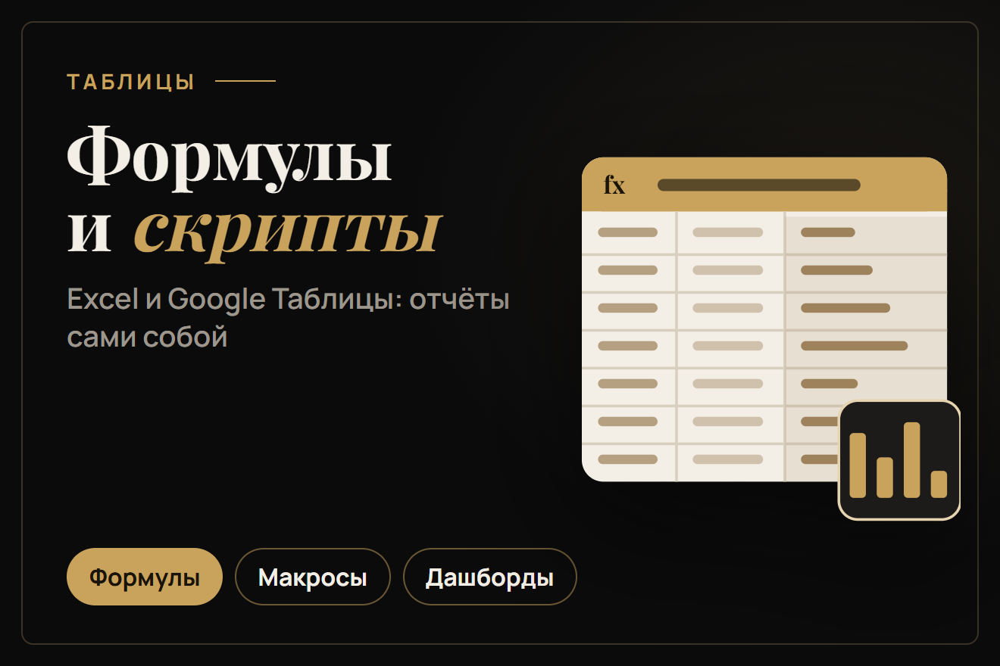

Таблицы, которые считают сами: формулы, условное форматирование, дашборды и учёт заказов, остатков, финансов.

**Зачем бизнесу:** Таблица считает сама, поэтому меньше ручной работы и ошибок в деньгах и остатках.

<table>
<tr><td width="33%" valign="top"><a href="portfolio/sheet-sales.png">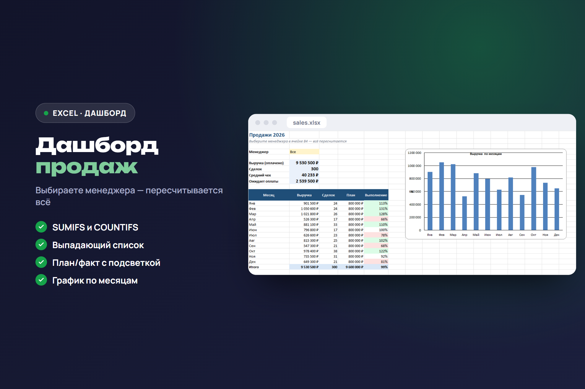</a> <b>Дашборд продаж</b> Выбираете менеджера в выпадающем списке, и пересчитывается весь дашборд: SUMIFS, COUNTIFS, план и факт с подсветкой, график по месяцам. Руководитель сразу видит, кто выполняет план. [код](https://github.com/grozeser/excel-demo)</td><td width="33%" valign="top"><a href="portfolio/sheet-payroll.png">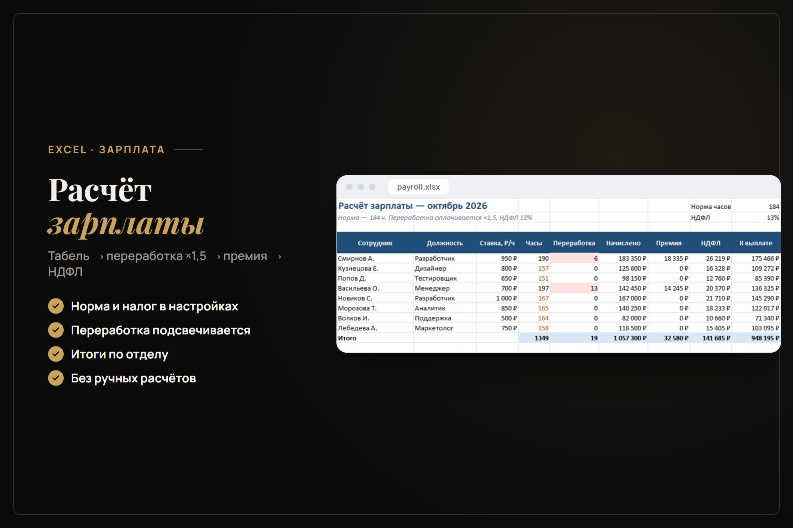</a> <b>Расчёт зарплаты</b> Табель превращается в зарплату: переработка ×1,5, премия и НДФЛ, норма и ставка налога вынесены в настройки. Переработки подсвечиваются, итоги считаются по отделу, ручных расчётов нет. [код](https://github.com/grozeser/excel-demo)</td><td width="33%" valign="top"><a href="portfolio/sheet-stock.png">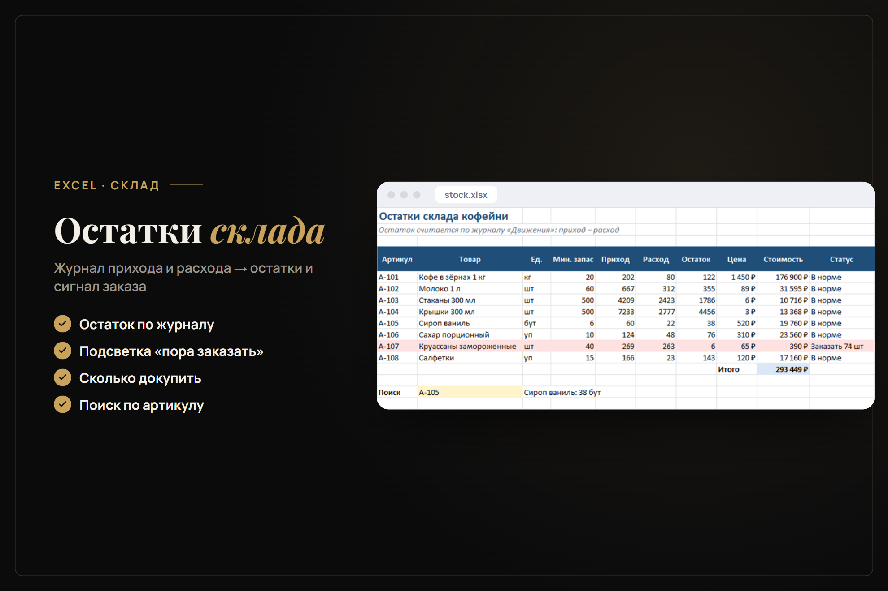</a> <b>Остатки склада</b> Остатки считаются по журналу прихода и расхода. Товары, которые пора заказать, подсвечиваются вместе с количеством к закупке, есть поиск по артикулу. Склад не заканчивается внезапно. [код](https://github.com/grozeser/excel-demo)</td></tr>
<tr><td width="33%" valign="top"><a href="portfolio/sheet-cashflow.png">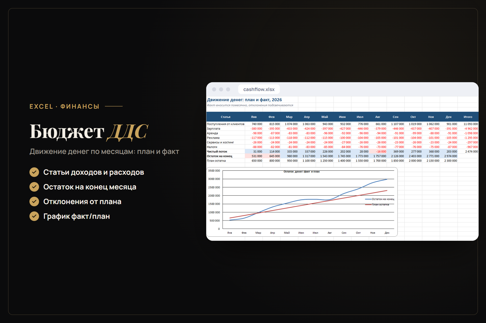</a> <b>Бюджет ДДС</b> Движение денег по месяцам: статьи доходов и расходов, остаток на конец месяца, отклонения от плана и график план/факт. Заранее видно, в каком месяце может не хватить денег. [код](https://github.com/grozeser/excel-demo)</td><td width="33%" valign="top"><a href="portfolio/sheet-itmarket.png">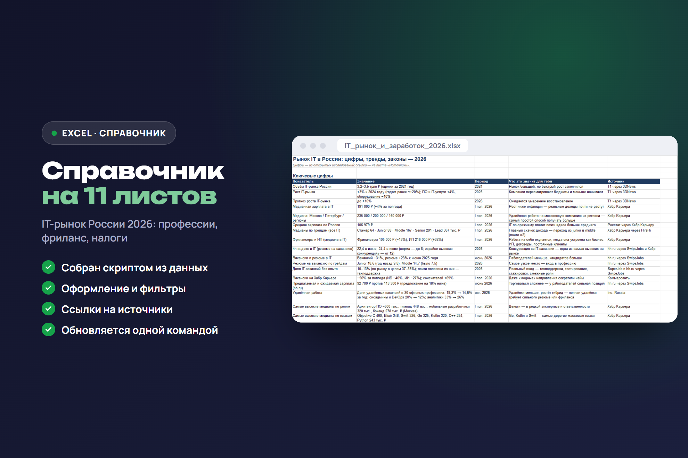</a> <b>Справочник на 11 листов</b> IT-рынок России 2026: профессии, фриланс, налоги. Собран скриптом из данных, с оформлением, фильтрами и ссылками на источники, обновляется одной командой. Так же собирается отраслевой справочник или прайс. файл по запросу</td></tr>
</table>

<a href="#услуги">↑ к списку услуг</a>

## 9. Запуск на сервере

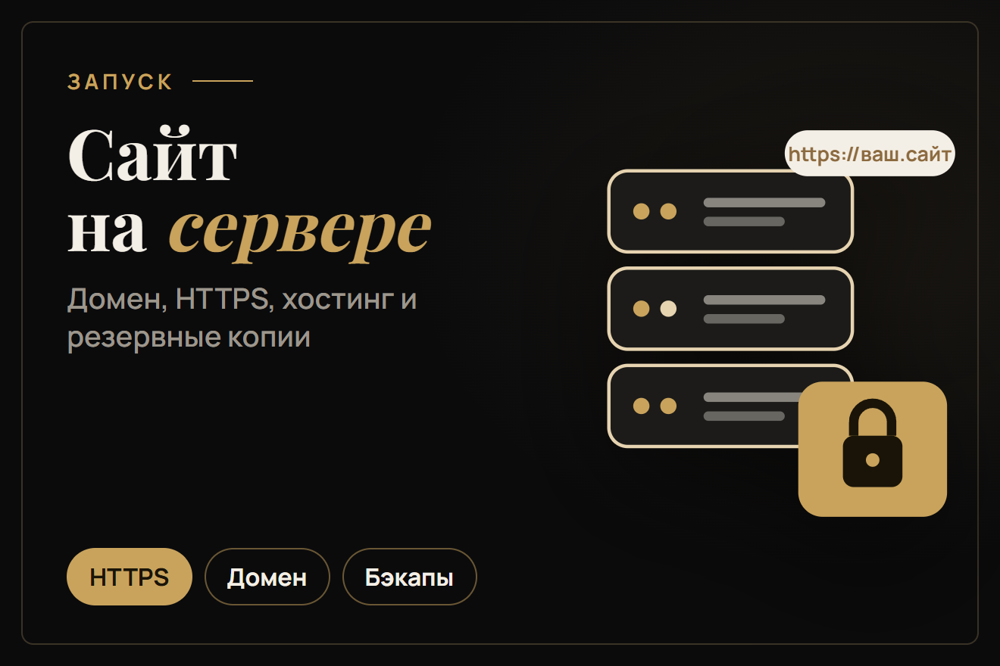

Опубликую сайт или бота: домен, HTTPS, Docker с автоперезапуском, резервные копии и инструкция.

**Зачем бизнесу:** Сайт и бот работают круглосуточно по HTTPS, а резервные копии берегут данные от потери.

<table>
<tr><td width="33%" valign="top"><a href="portfolio/deploy-stack.png">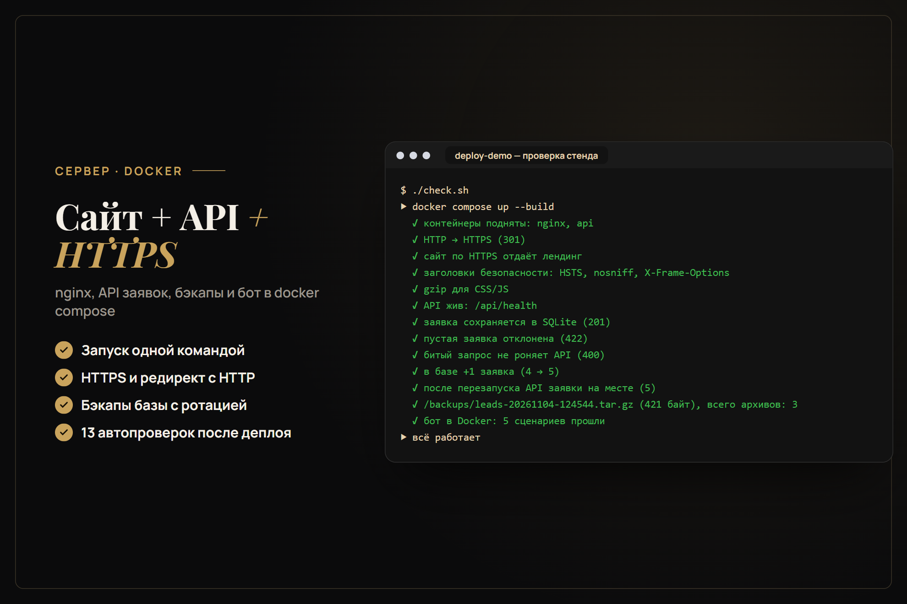</a> <b>Сайт + API + HTTPS в Docker</b> nginx, API заявок, бэкапы и бот в docker compose. Запуск одной командой, HTTPS с редиректом с HTTP, бэкапы базы с ротацией и 13 автопроверок после каждого деплоя. Если что-то сломалось, это видно сразу, а не от клиента. [код](https://github.com/grozeser/deploy-demo)</td><td width="33%" valign="top"><a href="portfolio/deploy-nginx.png">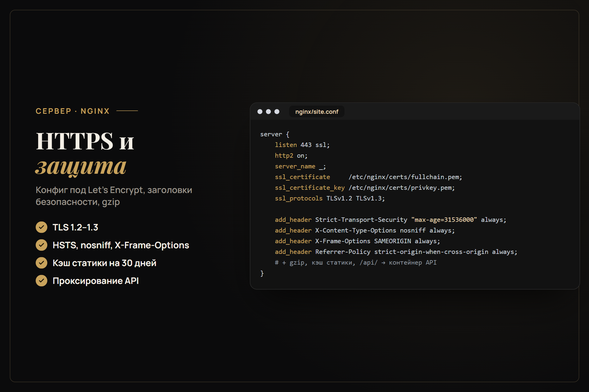</a> <b>nginx: HTTPS и защита</b> Конфиг под Let’s Encrypt: TLS 1.2–1.3, заголовки безопасности HSTS, nosniff и X-Frame-Options, gzip, кэш статики на 30 дней и проксирование API. Сайт открывается быстрее, а браузер показывает защищённое соединение. [код](https://github.com/grozeser/deploy-demo)</td><td width="33%" valign="top"><a href="portfolio/deploy-bot.png">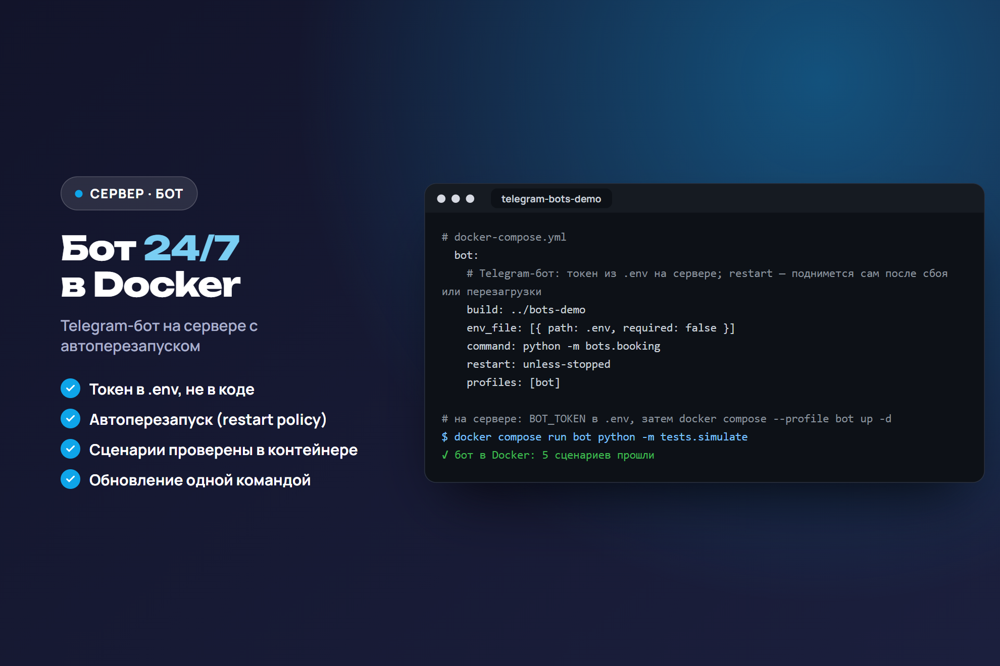</a> <b>Бот 24/7 в Docker</b> Telegram-бот в Docker с автоперезапуском, токен лежит в .env, а не в коде. Сценарии проверены прямо в контейнере, обновление одной командой. Бот сам поднимается после сбоя или перезагрузки сервера. [код](https://github.com/grozeser/deploy-demo)</td></tr>
<tr><td width="33%" valign="top"><a href="portfolio/deploy-ci.png">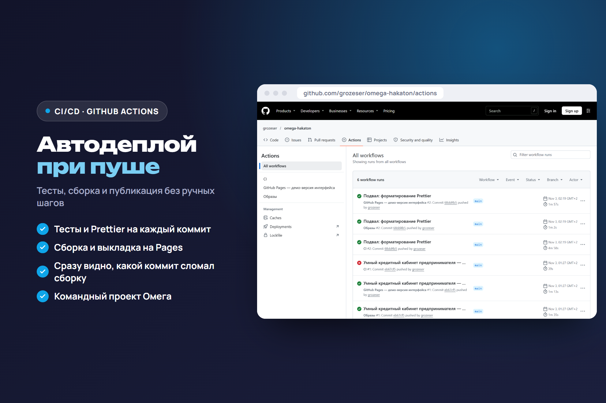</a> <b>Автодеплой через GitHub Actions</b> Тесты и Prettier на каждый коммит, сборка и выкладка на Pages. Сразу видно, какой коммит сломал сборку, а новая версия выходит без ручных шагов. Командный проект «Омега». [код](https://github.com/grozeser/omega-hakaton)</td><td width="33%" valign="top"><a href="portfolio/deploy-pages.png">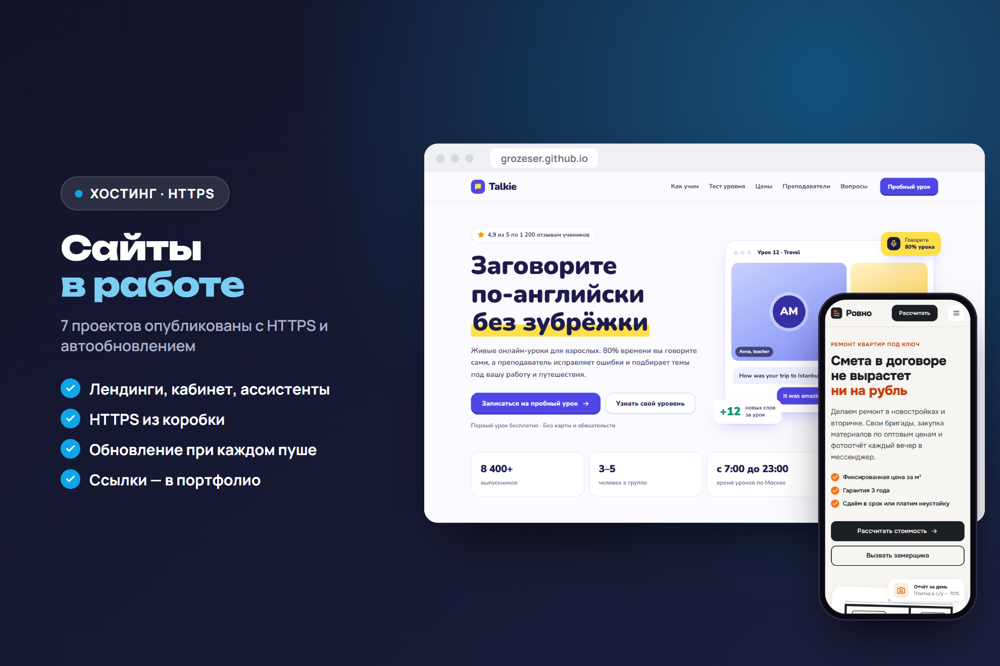</a> <b>7 сайтов с HTTPS</b> Лендинги, личный кабинет и ассистенты опубликованы с HTTPS и обновляются при каждом пуше. Ссылки на живые демо есть в этом портфолио. [все проекты](https://github.com/grozeser)</td></tr>
</table>

<a href="#услуги">↑ к списку услуг</a>

## Как я работаю

1. Обсуждаем задачу и согласуем, что получится в итоге.
2. Делаю и показываю промежуточный результат на тестовом адресе.
3. Вношу правки по вашим замечаниям, два круга правок.
4. Передаю доступы, исходники и короткую инструкцию.

Компании в демо-работах вымышленные, данные синтетические. «Омега» и «Штурман» — командные проекты с хакатонов.
